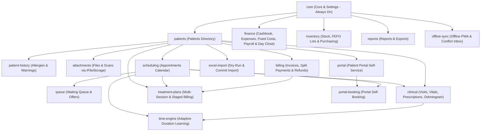

# Multi-Clinic Management Platform — Complete System Documentation

**Platform**: ASP.NET Core 10 Modular Monolith API + SQL Server (Row-Level Security) + React 19 / TypeScript PWA (Arabic RTL-First)  
**Documentation Scope**: Phases 0 through 16 (Full Production Baseline)  
**Companion Documents**:
- [API Reference](API.md)
- [Architecture & Build Log](PROGRESS.md)
- [Design Decisions](DECISIONS.md)
- [Operations & Production Runbook](OPERATIONS_RUNBOOK.md)
- [Implementation Plan & Gates](../PLAN.md)

---

## 1. Executive Summary & Architectural Principles

The Multi-Clinic Management Platform is a multi-tenant, multi-specialty clinic operations suite engineered as a **modular monolith** backed by **SQL Server** and a bilingual **Arabic (RTL default) / English (LTR secondary)** React Progressive Web App.

### Core Design Pillars
1. **Strict Multi-Tenant Isolation (`ITenantEntity`)**:
   - Every clinic-owned table implements `ITenantEntity` (`ClinicId`), protected simultaneously by **EF Core global query filters** and **SQL Server Row-Level Security (`FILTER` + `BLOCK` predicates via `TenantSessionInterceptor`)**.
   - Cross-clinic access fails closed with `404 Not Found` (never `403`, preventing existence oracle leaks).
   - Super Admin bypass is gated strictly through `IPlatformAccess` and writes an immutable `core.PatientAccessLogs` entry whenever patient data is inspected.
   - Multi-clinic Owners aggregate across clinics they own exclusively via `IOwnerPortfolio`, which switches into each clinic's tenant context one by one with RLS active.
2. **Modular Monolith with Explicit Contracts**:
   - Features are isolated into `BuildingBlocks` and `Core` (`Core.Domain`, `Core.Contracts`, `Core.Application`, `Core.Infrastructure`) plus switchable runtime modules governed by `ModuleCatalogService` (`ClinicModules`).
   - Direct use of MediatR or AutoMapper is avoided; plain application services, explicit mappings, and an append-only transactional outbox drive domain workflows cleanly.
   - Architecture fitness tests (`tests/ArchitectureTests`) enforce single-type-per-file discipline, thin HTTP controllers, endpoint authorization policies, anonymous allowlists, and DTO vs. Result/ViewModel separation.
3. **Three Isolated Authentication Realms & Two Physical Hosts**:
   - **Clinic Staff (`__Host-Staff-Token`)** — serves staff workflows on the clinic host.
   - **Patient Portal (`__Host-Portal-Token`)** — serves patient self-service endpoints on `/api/v1/c/{slug}/portal/**` on the clinic host; patient identity is derived strictly from signed JWT/cookie claims (`patient_id`, `clinic_id`), never from request parameters.
   - **Platform Super Admin (`__Host-Platform-Token`)** — serves `/api/v1/platform/**` strictly on the isolated Admin host (`HostRoutingMiddleware` returns `404` on any non-admin host), protected by mandatory **1-hour (3600s) TOTP**, single-use hashed recovery codes, replay rejection, and step-up password verification for privileged operations.
4. **Financial Append-Only Integrity**:
   - Monetary values use `decimal(18,2)` via the `Money` value object (never `double`/`float`).
   - Financial records are never hard-deleted (`IsVoided` / reversal entries only).
   - Receipt numbers and patient file numbers allocate strictly from pre-assigned `NumberBlock` ranges (`core.NumberBlocks`) — never `MAX() + 1`.
   - Closed financial days (`finance.DailyClosings`) lock retroactive changes; reopening requires `finance.reopen_day` and writes an audit entry.
   - Doctor commission was deliberately excluded by locked business decision.
5. **Sync-Ready From Phase 1 & Offline PWA (Phase 15)**:
   - Tenant entities track `RowVersion`, GUID v7 identifiers, and client `OperationId` idempotency (`core.ProcessedOperations`, `sync.SyncOperationLogs`).
   - Online-only actions (closing days, refunds, price lists, roles/claims, clinic onboarding/creation, module flags, admin host endpoints, security changes, patient portal routes, clinic ZIP export) reject offline sync calls with `ONLINE_ONLY_ACTION_FORBIDDEN` (`409` / `400`).

---

## 2. Solution & Workspace Topology

### 2.1 Backend (.NET 10 Projects)

| Project | Path | Responsibility |
|---|---|---|
| `BuildingBlocks` | `src/BuildingBlocks/BuildingBlocks.csproj` | Cross-cutting abstractions (`IClock`, `ICurrentClinic`, `IPlatformAccess`, `IEmailSender`, `IFileStorage`, `IVerificationCodes`, `Money`, `GuidV7`, `ITenantEntity`, `IAuditable`, `ISoftDeletable`, `TenantSessionInterceptor`) |
| `Core.Contracts` | `src/Modules/Core/Core.Contracts/Core.Contracts.csproj` | Public module contracts and manifests (`IModuleManifest`, interfaces) |
| `Core.Domain` | `src/Modules/Core/Core.Domain/Core.Domain.csproj` | Pure domain entities, enums, domain logic (`EffectivePermissionsEvaluator`, Arabic text normalizer, value objects) |
| `Core.Application` | `src/Modules/Core/Core.Application/Core.Application.csproj` | Use-case service interfaces, validated Input DTOs (`*Input.cs`), and output/ViewModel models (`*Result.cs`) |
| `Core.Infrastructure` | `src/Modules/Core/Core.Infrastructure/Core.Infrastructure.csproj` | `CoreDbContext`, EF Core entity/schema mappings, SQL Server RLS helpers, Hangfire/outbox dispatch, domain service implementations |
| `Platform.Api` | `src/Platform.Api/Platform.Api.csproj` | ASP.NET Core 10 HTTP host, 28 thin REST controllers, middleware pipeline, JWT/cookie auth schemes, authorization policy registration |

### 2.2 Verification Projects

| Project | Path | Scope |
|---|---|---|
| `UnitTests` | `tests/UnitTests/UnitTests.csproj` | Pure domain/application unit tests (196 tests across Phases 0–16) |
| `ArchitectureTests` | `tests/ArchitectureTests/ArchitectureTests.csproj` | Policy sweep, anonymous allowlist sweep, thin controller checks, dependency boundaries (15 tests) |
| `IntegrationTests` | `tests/IntegrationTests/IntegrationTests.csproj` | Real SQL Server via Testcontainers + Respawn; RLS, EF filters, number blocks, FEFO inventory, outbox emails, ZIP export (36 tests) |
| `Gates` | `tests/Gates/Gates.csproj` | End-to-end Phase 0–16 Integration Gates, automated 33-route cross-tenant `404` fuzzer, OWASP header checks (29 tests) |

### 2.3 Frontend (`web/` npm Workspaces)

| Workspace | Package Name | Path | Responsibility |
|---|---|---|---|
| Clinic PWA | `@clinic/clinic-app` | `web/apps/clinic` | Clinic staff workspace + lazy-loaded patient portal (`/c/:slug/portal`) + Vite PWA Workbox Service Worker |
| Super Admin App | `@clinic/admin-app` | `web/apps/admin` | Platform Super Admin console (`/platform/**`), step-up actions, read-only clinic Inspect Mode (`InspectClinicShell`) |
| API & Offline Engine | `@clinic/api-client` | `web/packages/api-client` | Typed API client, Dexie IndexedDB `ClinicOfflineDb` store, `outboxManager`, `useOfflineMutation` |
| Design System | `@clinic/ui` | `web/packages/ui` | Arabic RTL-first liquid-glass UI primitives (`GlassCard`, `GlassButton`, `GlassInput`, `CodeInput`, `AlertBanner`, `ThemeToggle`, `LanguageSwitcher`) |
| Feature Modules | `@clinic/feature-core` | `web/packages/features/core` | Auth, onboarding, RBAC, patients, scheduling, clinical, billing, treatment plans, portal admin/booking, inventory, time engine, finance/reports, offline sync |
| E2E Suite | Playwright | `web/e2e` | Offline Service Worker / IndexedDB sync & portal cache isolation (`offline-sync.spec.ts`), bilingual RTL/LTR & theme regression (`hardening-regression.spec.ts`) |

---

## 3. Switchable Module Catalog & Dependency DAG

`ModuleCatalogService` defines **`core` (always active)** plus **15 toggleable modules** (`16` entries total). Only a Platform Super Admin with step-up password authentication can enable or disable modules for a clinic (`POST /api/v1/platform/clinics/{clinicId}/modules`).

### Module Inventory Table

| Module Key | Arabic Title | English Title | Prerequisites | Schema(s) |
|---|---|---|---|---|
| `core` | الأساسيات والإعدادات | Core & Settings | *(None — mandatory)* | `core` |
| `patients` | ملفات المرضى | Patients Directory | *(None)* | `patients` |
| `patient-history` | التاريخ الطبي والحساسية | Medical History | `patients` | `patients` |
| `attachments` | المرفقات والصور | Attachments & Files | `patients` | `patients` |
| `scheduling` | المواعيد والجدولة | Scheduling & Appointments | `patients` | `scheduling` |
| `queue` | طابور الانتظار | Waiting Queue | `scheduling` | `queue` |
| `clinical` | الكشف والجلسات السريرية | Clinical Sessions | `patients`, `scheduling` | `clinical` |
| `billing` | الفواتير والمدفوعات | Billing & Invoices | `patients` | `billing` |
| `finance` | المالية والخزينة وإغلاق اليوم | Finance & Day Close | *(None)* | `finance` |
| `treatment-plans` | خطط العلاج | Treatment Plans | `patients`, `scheduling`, `billing` | `plans` |
| `inventory` | المخزون والمستلزمات | Inventory & Supplies | *(None)* | `inventory` |
| `time-engine` | محرك الزمن ومؤشرات التاخير | Time & Delay Analytics | `scheduling`, `clinical` | `time_engine` |
| `reports` | التقارير والتصدير | Reports & Exports | *(None)* | `reports` |
| `excel-import` | استيراد ملفات إكسل | Excel Data Import | `patients` | `import` |
| `portal` | بوابة المريض | Patient Portal | `patients` | `portal` |
| `portal-booking` | حجز المواعيد من البوابة | Portal Online Booking | `portal`, `scheduling` | `portal`, `scheduling` |
| `offline-sync` | المزامنة دون اتصال | Offline Sync | *(None)* | `sync`, `core` |

---

## 4. Database Architecture & SQL Server Schema Map

`CoreDbContext` partitions domain entities across **14 SQL Server schemas** inside a single shared database protected by SQL Server Row-Level Security (`sys.security_policies`) and `TenantSessionInterceptor` (`sp_set_session_context`).

| Schema | Tables (`CoreDbContext` Mappings) |
|---|---|
| `core` | `Users`, `Roles`, `UserRoles`, `UserClaims`, `UserLogins`, `RoleClaims`, `UserTokens`, `Clinics`, `Owners`, `UserClinics`, `VerificationCodes`, `AppDevices`, `RefreshTokens`, `AuditLogs`, `OutboxMessages`, `PlatformAdmins`, `TenantSampleRecords`, `PatientAccessLogs`, `ClinicSlugs`, `OnboardingProgress`, `ClinicSpecialties`, `ClinicAssets`, `ClinicModules`, `ClinicRoles`, `ClinicRolePermissions`, `UserPermissionOverrides`, `UserDashboardLayouts`, `ClinicRooms`, `ClinicDoctors`, `ClinicWorkingHours`, `ClinicDaysOff`, `NumberBlocks`, `ProcessedOperations` |
| `patients` | `Patients`, `PatientAllergies`, `PatientNotes`, `PatientAttachments` |
| `scheduling` | `AppointmentCategories`, `DoctorBookingSettings`, `ClinicSchedulingSettings`, `Appointments` |
| `queue` | `QueueEntries`, `WaitingListEntries`, `SlotOffers` |
| `clinical` | `Visits`, `VisitVitals`, `VisitDiagnoses`, `VisitProcedures`, `Prescriptions`, `PrescriptionItems`, `LabOrders`, `ClinicalForms`, `VisitFormData`, `ToothRecords` |
| `billing` | `PriceListItems`, `Charges`, `ChargeLines`, `LedgerEntries`, `Payments`, `PaymentAllocations`, `Refunds`, `SkippedReceiptNumbers`, `LabWorkOrders` |
| `finance` | `Suppliers`, `SupplierPayments`, `Expenses`, `DailyClosings`, `ClosingMethodTotals`, `FixedCosts`, `Employees`, `PayrollRuns`, `PayrollLines`, `PayrollAdjustments` |
| `plans` | `TreatmentPlans`, `PlanSessions`, `PlanPaymentScheduleItems` |
| `portal` | `PatientAccounts`, `PortalConsents`, `ClinicPortalSettings`, `ClinicPortalBookingSettings` |
| `inventory` | `InventoryItems`, `InventoryItemBatches`, `StockMovements`, `PurchaseInvoices`, `PurchaseInvoiceLines`, `ClinicInventorySettings`, `InventoryAlerts` |
| `time_engine` | `SessionDurations`, `CategoryTimeStats`, `DoctorTimeEngineSettings`, `ClinicTimeEngineSettings` |
| `reports` | `ReportExportLogs`, `ScheduledReportConfigs` |
| `import` | `ImportBatchLogs` |
| `sync` | `SyncDeviceStates`, `SyncOperationLogs`, `SyncConflicts`, `ClinicSyncSettings` |

---

## 5. Authentication, Authorization & Security Hardening

### 5.1 Three-Realm Authentication Pipeline (`Program.cs`)
- **Cookie & Bearer Resolution (`OnMessageReceived`)**:
  - Admin Host -> reads `__Host-Platform-Token`.
  - Clinic Host (`/api/v1/c/**`) -> prefers `__Host-Portal-Token`, falls back cleanly to `__Host-Staff-Token` for staff portal directory/management calls where permitted.
  - Clinic Host (all other `/api/**`) -> reads `__Host-Staff-Token`.
- **Realm & SecurityStamp Enforcement (`OnTokenValidated`)**:
  - Rejects `PlatformAdmin` tokens on the clinic host and non-`PlatformAdmin` tokens on the admin host.
  - Restricts `PatientPortal` tokens strictly to `/api/v1/c/**` routes and validates `PatientAccounts.Status == Active` + `SecurityStamp` against the database on every request.
  - Validates staff `Users.SecurityStamp` to enforce immediate revocation upon password reset, email change, or device revocation.
  - Enforces token timestamps through injected `IClock` (testable deterministic expiry).

### 5.2 Effective Permission Formula (`EffectivePermissionsEvaluator`)
Effective clinic permissions are computed server-side per request/version stamp:

$$\text{Effective} = \big((\text{RoleClaims} \cup \text{UserGrants}) \setminus \text{UserDenies}\big) \cap \text{EnabledModulePermissions}$$

- **Deny always wins**: explicit user denies remove any permission granted via role or user override.
- **No privilege escalation**: a user may only grant permissions they currently hold.
- **Owner-reserved permissions** (cannot be assigned to custom roles or non-owner grants):
  - `roles.manage`
  - `clinic.settings.edit`
  - `users.manage`
  - `clinic.export`

### 5.3 HTTP Hardening & Response Headers (`SecurityHeadersMiddleware`)
Applied across all responses from `Platform.Api`:
- `X-Content-Type-Options: nosniff`
- `X-Frame-Options: DENY`
- `Referrer-Policy: no-referrer`
- `Permissions-Policy: camera=(), microphone=(), geolocation=(), payment=(), usb=()`
- `Content-Security-Policy: default-src 'self'; script-src 'self'; style-src 'self' 'unsafe-inline'; img-src 'self' data: blob:; font-src 'self' data:; connect-src 'self'; object-src 'none'; frame-ancestors 'none'; base-uri 'self'; form-action 'self'`
- `Strict-Transport-Security: max-age=31536000; includeSubDomains; preload` (outside Development)
- `Cache-Control: no-store, no-cache, max-age=0, must-revalidate` and `Pragma: no-cache` on `/api/**` and `/c/**` routes

### 5.4 Verification Codes & Sensitive Flows
- All verification codes are 6-digit codes stored only as server-keyed HMACs bound to `(UserId, Purpose)` via `IVerificationCodes` (`VerificationCodes`), with expiration, attempt caps (5 attempts), resend cooldowns, and rate limiting.
- Passwordless/plain-text or emailed passwords are forbidden platform-wide.

---

## 6. REST API Surface (`Platform.Api/Controllers`)

| Controller | Base Route | Primary Scope |
|---|---|---|
| `HealthController` | `/api/v1/health` | Service & DB readiness health probe |
| `AuthController` | `/api/v1/auth` | Staff registration/activation, login, refresh rotation, forgot/reset password, email verification, device revocation |
| `ProfileController` | `/api/v1/profile` | Current staff user profile & preferences |
| `ClinicsController` | `/api/v1/clinics` | Owner clinic list, owner clinic creation (quota-checked), clinic switching, onboarding wizard, owner portfolio summary |
| `ClinicStructureController` | `/api/v1/clinics/{clinicId}` | Rooms, doctors, specialties, working hours, days off, clinic logos/assets |
| `ClinicExportController` | `/api/v1/clinics/{clinicId}/export` | Owner-only full clinic ZIP archive (`clinic.export`, Arabic UTF-8 JSON, zero secrets, audited) |
| `ModulesController` | `/api/v1/clinics/{clinicId}/modules` | Effective module manifests, navigation menus, settings sections |
| `RolesPermissionsController` | `/api/v1/clinics/{clinicId}` | Custom clinic roles, permission catalog, user role/grant/deny overrides |
| `DashboardsController` | `/api/v1` | Bounded module dashboard widget endpoints & per-user layout persistence |
| `PatientsController` | `/api/v1/clinics/{clinicId}/patients` | Arabic-normalized search, patient profiles, allergies/chronic alerts, clinical/private notes, signed attachments |
| `SchedulingController` | `/api/v1/clinics/{clinicId}` | Categories, appointments calendar, double-booking conflict guard, priority flags, queue board, waiting list & slot offers |
| `ClinicalController` | `/api/v1/clinics/{clinicId}/clinical` | Visits, live timers, vitals, diagnoses/procedures, allergy-checked prescriptions, lab orders, dynamic specialty forms, odontogram |
| `BillingController` | `/api/v1/clinics/{clinicId}/billing` | Price list, itemized charges, free-session/custom-price reasons, split payments, allocations, `NumberBlock` receipts, refunds, lab work orders |
| `TreatmentPlansController` | `/api/v1/clinics/{clinicId}/treatment-plans` | Fixed-total & per-session plans, scheduled sessions, payment installments |
| `FinanceController` | `/api/v1/clinics/{clinicId}/finance` | Cashbook, suppliers & payments, daily expenses, daily close/reopen lock, fixed costs, employees & payroll runs (no commission) |
| `InventoryController` | `/api/v1/clinics/{clinicId}/inventory` | Items, FEFO batches/expiry, purchase invoices, manual/session stock movements, alerts |
| `TimeEngineController` | `/api/v1/clinics/{clinicId}/time-engine` | Category stats, adaptive session duration learning, doctor/clinic threshold toggles |
| `ReportsController` | `/api/v1/clinics/{clinicId}/reports` | Dapper-backed operational/financial reports, CSV/PDF export, scheduled reports |
| `ExcelImportController` | `/api/v1/clinics/{clinicId}/import` | Dry-run validation + atomic transactional commit for spreadsheet imports |
| `StaffPortalManagementController` | `/api/v1/clinics/{clinicId}/portal` | Patient consent capture, portal invites/one-time PINs, booking approval requests, no-show block toggles |
| `PublicClinicDirectoryController` | `/api/v1/c` | Public clinic slug directory & branding metadata (`portal` module gated; unknown or disabled returns `404`) |
| `PatientPortalController` | `/api/v1/c/{slug}/portal` | Patient activation/login, appointments, visits, prescriptions, signed attachment downloads, self-booking & cancellation |
| `SyncController` | `/api/v1/clinics/{clinicId}/sync` | Offline device registration, `NumberBlock` leasing, idempotent operation batch push, delta change feed pull, conflict resolution |
| `PlatformAuthController` | `/api/v1/platform/auth` | Super Admin login + mandatory 1-hour TOTP enrollment/verification + recovery codes |
| `PlatformClinicsController` | `/api/v1/platform/clinics` | Cross-clinic provisioning, module toggling with DAG validation, clinic suspension/ownership transfer, Inspect Mode access |
| `PlatformOwnersController` | `/api/v1/platform/owners` | Owner lifecycle, clinic creation quotas, deactivation (step-up gated) |
| `PlatformMonitoringController` | `/api/v1/platform` | System-wide audit/access logs, security telemetry, alert dashboards |
| `PlatformReportsController` | `/api/v1/platform/reports` | Platform-level SaaS & utilization analytics |

---

## 7. Frontend Architecture & Offline PWA Engine

- **RTL-First Styling**: All layout rules in `@clinic/ui` (`liquid-glass.css`) and feature packages use CSS logical properties (`margin-inline-start`, `padding-inline-end`), Arabic primary copy with English fallback (`i18n`), and full Light/Dark theme tokens.
- **Patient Portal Isolation (`web/apps/clinic/src/portal`)**: Lazy-loaded route tree (`PortalApp`) containing zero staff bundles; `vite.config.ts` configures Workbox (`vite-plugin-pwa`) so Service Worker runtime caching never intercepts `/c/*/portal/**` or `/api/**` routes.
- **Offline Outbox & Sync (`@clinic/api-client`)**:
  - `ClinicOfflineDb` (Dexie IndexedDB) stores `outbox`, `syncMeta`, `numberBlocks`, and `conflicts`.
  - Every mutation flows through `useOfflineMutation` / `outboxManager` with client-generated GUID v7 `OperationId`; online-only mutations pass `onlineOnly: true` and fail fast with localized messaging when `navigator.onLine === false`.
  - Revoked devices (`DEVICE_REVOKED`) automatically purge local IndexedDB storage.

---

## 8. Owner Full-Clinic ZIP Export (`ClinicExportService`)

- Protected by owner-reserved permission `clinic.export` (`RolesPermissions` blocks delegation to non-owner roles) and online-only enforcement (`ONLINE_ONLY_ACTION_FORBIDDEN`).
- Runs inside `ClinicTenantScopeHelper.ExecuteForClinicAsync` so only the requested clinic's data passes RLS.
- Generates an in-memory UTF-8 ZIP package (using `JavaScriptEncoder.UnsafeRelaxedJsonEscaping` so Arabic patient names/notes remain readable without `\uXXXX` escaping) containing:
  - `manifest.json`, `clinic.json`, `patients.json`, `appointments.json`, `visits.json`, `charges.json`, `payments.json`, `treatment_plans.json`, `inventory_items.json`, `fixed_costs.json`, `employees.json`
- Explicitly excludes all sensitive credentials (`PasswordHash`, `SecurityStamp`, verification codes, refresh tokens).
- Writes an immutable `ClinicDataExported` entry in `core.AuditLogs`.

---

## 9. Quality Gates & Verification Pyramid

| Layer | Suite / Script | Purpose & Guarantees | Latest Verified Scope |
|---|---|---|---|
| Unit | `tests/UnitTests/UnitTests.csproj` | Domain math (`Money`, permissions, scheduling overlaps, time engine, FEFO math, sync conflict rules, ZIP export hygiene) | **196 / 196 passed** |
| Architecture | `tests/ArchitectureTests/ArchitectureTests.csproj` | Policy enforcement on every endpoint, anonymous allowlist, thin controllers, DTO separation, single type per file | **15 / 15 passed** |
| Integration | `tests/IntegrationTests/IntegrationTests.csproj` | Real SQL Server via Testcontainers + Respawn: RLS filter/block policies, `sys.indexes` on all 31 tenant tables, transactions, Dapper reports, <2000ms widget SLA | **36 / 36 passed** |
| Phase Gates | `tests/Gates/Gates.csproj` | Cumulative Phase 0–16 acceptance suites + production security headers (`HSTS`, `CSP`, `no-store`) + automated 33-route cross-tenant `404` fuzzer | **29 / 29 passed** |
| Frontend Unit | `npm --prefix web test` | Vitest + React Testing Library across `admin-app` (7), `clinic-app` (5), `api-client` (7), `ui` (3), `feature-core` (43) | **65 / 65 passed** |
| Type Check & Build | `npm --prefix web run lint` / `build` | Strict `tsc --noEmit` across all 5 workspaces + Vite production + Workbox Service Worker build (`dist/sw.js`) | **0 errors** |
| E2E Browser | Playwright (`web/e2e`) | Real Chromium `setOffline` PWA shell navigation, pending badge auto-flush, portal uncached enforcement, bilingual RTL/LTR & Light/Dark themes | **2 / 2 passed** |

